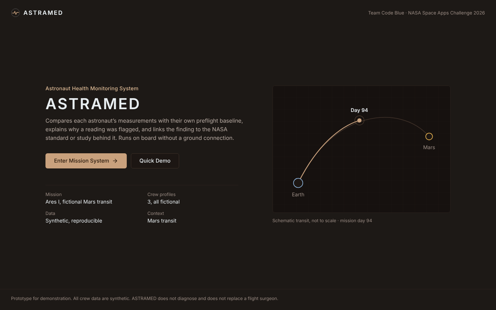
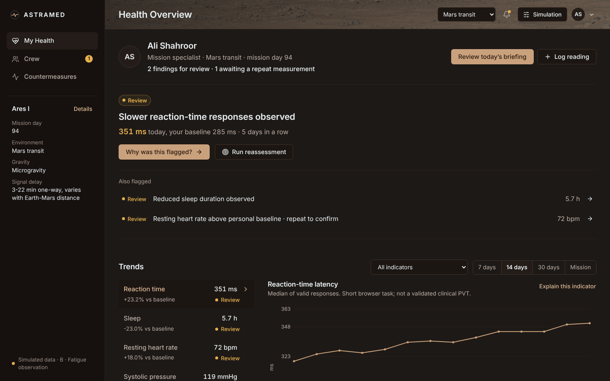
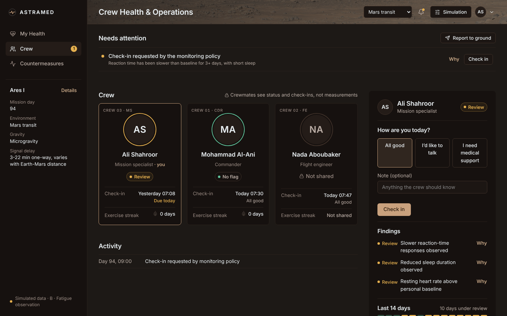
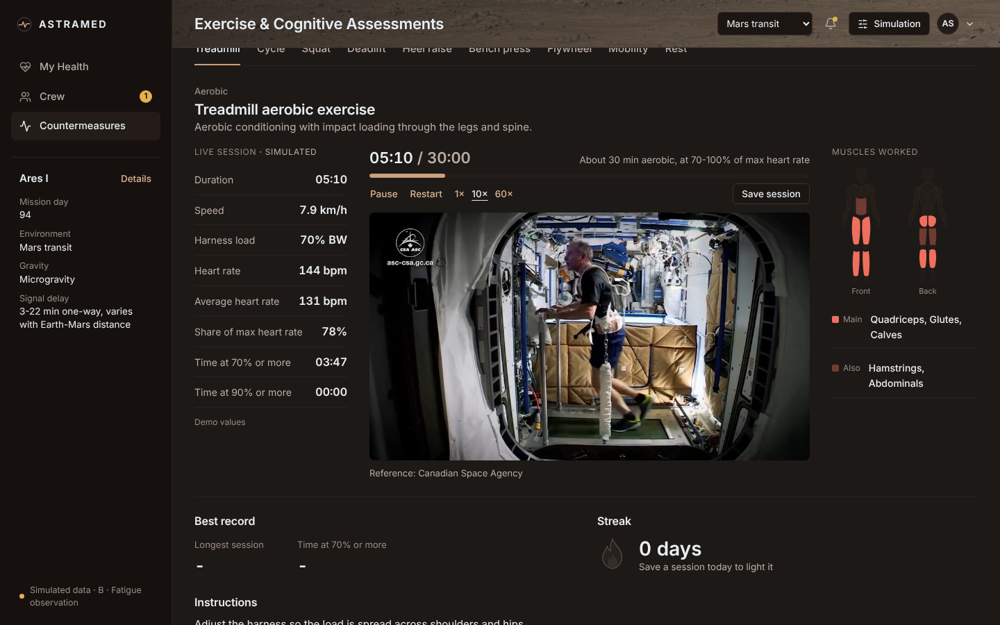
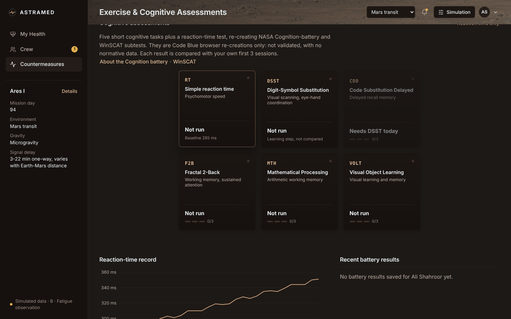

# ASTRAMED

**Live demo: https://alishahroor.github.io/astramed-prototype/** · Repository: https://github.com/AliShahroor/astramed-prototype

**Understand the change. Inspect the evidence. Make the next check.**

ASTRAMED is Team Code Blue’s local-first astronaut health-monitoring and decision-support prototype, developed for the brief “Create Health Monitoring Software for Astronauts on Space Missions.” It uses fictional adults and reproducible synthetic measurements. It does not diagnose disease, prescribe treatment, determine fitness for duty, or replace flight surgeons.

## Screens

| | |
|---|---|
| **Welcome**<br> | **My Health**<br>Personal readings against your own baseline, with an explainable health card for anything flagged.<br> |
| **Crew**<br>Player cards with status, check-in and exercise streak. Crewmates see status, never measurements.<br> | **Exercise**<br>One tab per exercise: live demo metrics, a looping clip with a session bar, the muscles worked, best record and streak.<br> |
| **Cognitive**<br>Short tests modelled on NASA's WinSCAT battery, each compared with your own first sessions.<br> | |

Screens show synthetic demo data (scenario B, mission day 94).

## Run locally

Requires Node.js 22.12+ (tested with Node 25.1.0) and npm. From this directory:

```sh
npm ci
npm run dev
```

Open the URL printed by Vite (normally http://127.0.0.1:5173). No account, credentials, backend or remote API is required. The root project is independent of any other project folders in this workspace.

To test the production/offline build:

```sh
npm run build
npm run preview -- --port 4173
```

Open http://127.0.0.1:4173, allow its service worker to finish installing, and look for **Offline cache ready**. Offline support is intentionally enabled only for production builds. A local development server is not an offline demonstration.

## The demonstration

The app opens on a welcome screen. **Enter Mission System** leads to crew profile selection (three profiles, or continue as guest), then a mission briefing that can be skipped on later visits, then the workspace. **Quick Demo** goes straight to the workspace as Ali Shahroor. No password or account is involved; every screen is directly linkable (`#/health`, `#/crew`, `#/countermeasures/cognitive`), and a direct link opens the workspace as the guest profile. The profile menu switches profile, reopens the briefing, returns to profile selection, signs out of the demo session or restarts the demonstration. Scenario, mission day, voice and export live under **Simulation** in the header. The selected environment (Mars transit, orbital station, lunar surface, Earth reference) re-tints the interface; status colours and reference limits never change.

Start with Ali Shahroor, Mars transit, mission day 94, scenario B. The current synthetic reaction-time latency of 351 ms is compared with a seeded 285 ms baseline, yielding a calculated +23.2% change. Inspect the Health Card for the exact rule, persistence, sleep context, limitations and local NASA evidence record. Run the short reaction-response assessment in Countermeasures → Cognitive, save the result, and return to My Health to inspect the updated finding. Crew shows limited statuses and deduplicated local check-in notifications. Scenario C changes the underlying cabin one-hour CO₂ average to 4.1 mmHg; the app calculates its 1.1 mmHg exceedance of the pinned 3 mmHg reference.

The optional voice setting reads the same deterministic finding. Reset and JSON export are under Demo & preferences in the profile menu.

## Implemented features

- Entry flow: welcome → demo access → mission briefing (skippable per profile) → My Health.
- Three responsive sections: Personal Health Overview, Crew Health & Operations, and Exercise & Cognitive Assessments.
- Crew operations dashboard: attention queue, player cards for each crew member (they scale to any crew size and put anyone needing attention first), crew-member detail with shared 14-day wellness trends (only for profiles that share), attention timeline recalculated per day, notification table with acknowledge/dismiss/review, check-in requests and an activity log.
- Cognitive battery of five tasks modelled on NASA’s WinSCAT (Code Substitution, Running Memory CPT, Mathematical Processing, Delayed Matching to Sample, Code Substitution Delayed) plus simple reaction time, each with practice, keyboard input, accuracy, median response time, throughput and a personal baseline built from the first three sessions.
- Exercise page with one tab per exercise (treadmill, cycle, squat, deadlift, heel raise, bench press, flywheel, mobility, rest): live simulated metrics, a looping clip from Canadian Space Agency and NASA footage (stored for offline use), a session bar sized from ISS practice (about 30 min aerobic, 30 to 60 min resistance), the muscles worked, best record and a daily streak.
- Three astronauts, 94 days of deterministic history and three scenarios.
- Global astronaut, day and environment selectors; four time windows and five hazard filters.
- Ten scalar indicators, including both blood-pressure components; charts with baselines, tooltips and a keyboard-accessible data table.
- Calculated Explainable Health Cards, local evidence viewer and original NASA source links.
- Validated manual readings with timestamp/unit metadata and locally saved results.
- Actual reaction-response timing, practice, five valid trials, false-start/timeout/hidden-tab exclusion, median aggregation and updated personal findings.
- Privacy-conscious shared crew view, simulated acknowledgements and check-ins.
- Illustrative activity checklists, completion totals, day streaks and assessment history.
- Optional speech synthesis, local export/reset, versioned production service-worker caching.

## Scientific sources and data provenance

NASA science informs measurement selection, hazard context and the two pinned reference comparisons. All astronaut profiles, baselines, mission context and seeded measurements are synthetic; no NASA experimental observations are represented as crew telemetry. Manual readings are marked as user-reported, and task results as browser-timed. OSDR was investigated; no experimental dataset was incorporated because no matching personal monitoring dataset was selected.

Sources are recorded in [the evidence mapping](docs/scientific-sources/evidence-mapping.md). Core references include NASA Spaceflight Standard Measures, the HRP ISS psychomotor-vigilance task, OCHMO-TB-004 (citing NASA-STD-3001 Vol 2 Rev D V2 6004), and NASA-STD-3001 Vol 1 Rev C V1 4030. The app pins these references; it does not claim certification against the latest standard. The older Rev D PDF URL returned 404, so its accessible official technical brief is the evidence link.

The sleep, reaction-time and heart-rate percentage rules are **unvalidated Code Blue demonstration rules**, not NASA clinical thresholds. Environment changes affect displayed operational context, not physiological limits. “Nominal” (shown as “No flag”) means no implemented rule triggered, never medical clearance.

## Stack and architecture

React 19, TypeScript, Vite, Tailwind CSS 4, Lucide and Recharts. Styling, icons and evidence are packaged locally, without external fonts. Domain calculations live outside presentation code. Browser localStorage persists prototype state. Native dialog provides modal focus handling; the task uses performance.now() and browser animation scheduling.

See [architecture](docs/implementation/architecture.md), [methodology](docs/implementation/methodology.md), [synthetic data](docs/implementation/synthetic-data.md), [limitations](docs/implementation/limitations.md), and [AI disclosure](docs/submission/ai-disclosure.md).

## Validation

```sh
npm test
npm run lint
npm run build
npm run test:e2e
```

The Playwright configuration uses locally installed Google Chrome (`channel: chrome`). Install Chrome or change that configuration to a Playwright Chromium installation (`npx playwright install chromium`). Browser tests launch the production preview on port 4173. They include a real timed five-trial response sequence, storage round trip, scenarios, crew actions, responsive screenshots, accessibility scans and an offline reload. Results and limits are in [the validation record](docs/validation/results.md). Screenshots are generated by the responsive browser test.

## Deployment

The build is a static `dist/` directory. With a GitHub/Vercel account, publish the source, import the repository into Vercel, use `npm run build` and output directory `dist`, and select an appropriate Node version. A root-domain deployment needs no route rewrite because navigation is in-app. Subdirectory hosting is supported: build with `npm run build -- --base=/your-project/` and serve that same base path. Manifest assets and worker registration follow the base. Never publish real personal medical records or local browser exports.

[Deployment instructions](docs/submission/deployment.md) describe release checks. The approved source is public at [AliShahroor/astramed-prototype](https://github.com/AliShahroor/astramed-prototype), and the application is live on [GitHub Pages](https://alishahroor.github.io/astramed-prototype/). The included workflow verifies lint, tests and build before deployment. See the validation record for observed live-browser results. The separate existing astramed repository/site and local template copy are preserved. No competition submission has been performed. The [30-second storyboard](docs/submission/demo-storyboard.md) and [seven-slide outline](docs/submission/presentation-outline.md) prepare the submission; final competition rules and deadlines must be checked by the team.

## Team and disclosure

Team Code Blue · ASTRAMED. AI-assisted code, design, documentation and synthetic data generation are disclosed in [ai-disclosure.md](docs/submission/ai-disclosure.md). No NASA marks, generated astronaut images, model training claim or NASA endorsement are used. The prototype needs independent engineering, scientific and clinical review before any operational use.
